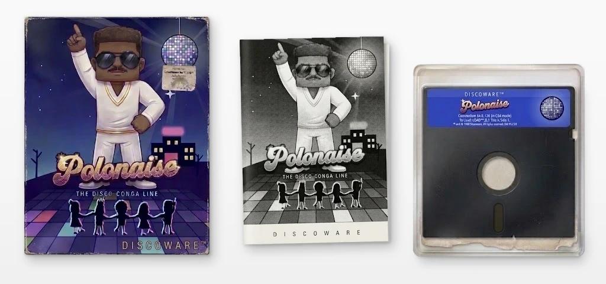
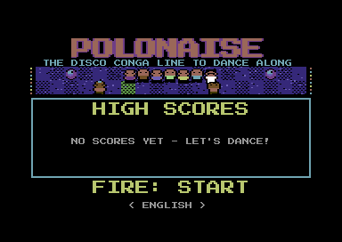
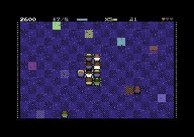
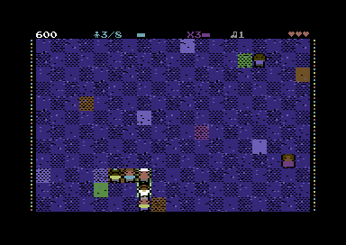
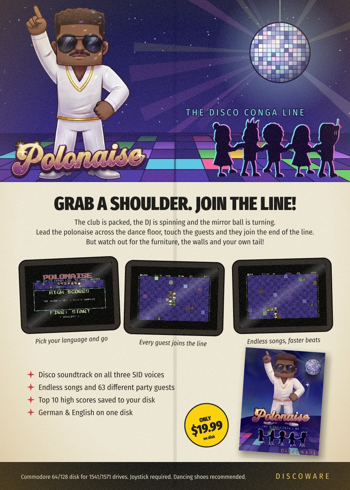

# Polonaise for the C64



The disco conga line to dance along with – the browser version (`../polonaise-c64`) as a real C64 program,
on a D64 disk image for emulators and original hardware.

*(The box, the manual and Discoware are made up – there never was a release in 1988. The game on the disk is real.)*

**The disk: `polonaise.d64`** (also `build/polonaise.d64`)

```
LOAD"POLONAISE",8,1
RUN
```

(or `LOAD"*",8,1`). With a stock 1541 loading takes about 45 seconds; with JiffyDOS, a fast loader
cartridge or a 1541 Ultimate it is correspondingly faster.

| Title screen                         | In the game                         |                                     |
|--------------------------------------|-------------------------------------|-------------------------------------|
|  |  |  |

## Controls

| Input                          | Effect                                                    |
|--------------------------------|-----------------------------------------------------------|
| Joystick (port 2, also port 1) | steer the polonaise                                       |
| Fire                           | start, continue; in the game: pause                       |
| Fire while paused              | continue; hold fire: end the game                         |
| Joystick left/right on title   | language German/English                                   |
| Name entry                     | up/down: letter, left/right: position, fire: OK           |

On the keyboard as well: RUN/STOP or P – pause, Q – end the game (while paused), F1 – language;
in the name entry the name can also be typed (DEL, RETURN).
Sound is always on, the game is always full screen.

## The high score list

The 10 best results are kept in the file `POLONAISE.HI` on the disk the game was loaded from
(with name, points, song reached, the last name entered and the language). It is rewritten after
a new entry – the disk must not be write-protected for that, otherwise "DISK ERROR: NOT SAVED"
appears and the list only lasts until the machine is switched off.

## What is the same and what is different

The game logic is the same: `src/game.s` is a port of `game.ts` with the same time base
(60 logic ticks per second, on PAL 6 ticks in 5 frames), the same songs, layouts, points, extra
lives and even the same random number generator. `tests/logic_test.py` runs both versions side by
side with the same inputs and compares the whole state after every tick.

The graphics are carried over to the C64: the playfield (19 × 12 cells of 16 × 16 pixels) is a
multicolor bitmap, the status line and info panels are text lines, with a raster interrupt
switching between them. The figures are built from the same descriptions as in the browser
(hair styles, dresses, glasses, 63 guest looks), only at half the horizontal resolution and with
the colors the C64 allows per 4 × 8 block. The polonaise jumps from cell to cell (the browser
glides between cells – that is not feasible with up to 25 figures on the C64).
The DJ, floating points, confetti, star sparkles, dizzy stars, "!" above fleeing guests and
"JOYSTICK: GO!" are hardware sprites.

The music is the arcade's disco loop (16 bars, 120 bpm: bass drum, clap, hi-hats, octave bass,
chords, melody) as SID music, the effects are modeled on the sounds of the original. Bass and
drums share the first SID voice, chords and melody the second; the third belongs to the effects
alone, so they never interrupt the music.
`tests/game_sound.py` plays a game with music and effects and renders it with reSID to
`build/game_sound.wav` (needs `pip install pyresidfp`).

Not carried over: the mirror ball light spots, the glowing band under the polonaise, the
semi-transparent panels (they cover the field behind them) and the top/bottom LED rows of the
frame.

## As advertised in 1988

[](docs/ad.webp)

## The web page

`docs/` is also the project's GitHub Pages site: `docs/index.html` (in the style of the 1988 ad),
`docs/impressum.html` (legal notice and privacy policy, in German), the favicon (a mirror ball,
drawn by `tools/favicon.py`), the screenshots, the fonts
(Fira Sans Compressed and Condensed, Press Start 2P – all SIL Open Font License, served from the
site itself) and a copy of the disk, `docs/polonaise.d64`, which `make` keeps up to date.
To publish it: in the repository settings under *Pages*, choose *Deploy from a branch*, the
branch and the folder `/docs`. To look at it locally: `python3 -m http.server --directory docs`.

## Building

Requires: gcc/make (for cc65 and Exomizer), Python 3, for the tests Node.js and Denise.

```
git clone --depth 1 https://github.com/cc65/cc65.git tools/cc65 && make -C tools/cc65 bin
git clone --depth 1 https://bitbucket.org/magli143/exomizer.git tools/exomizer && make -C tools/exomizer/src
python3 -m venv tools/venv && tools/venv/bin/pip install pillow numpy py65
make
```

`make` generates the files in `gen/` from `tools/gfx.py` (graphics, character set, sprites),
`tools/text.py` (texts) and `tools/music.py` (music, effects), assembles `src/main.s` into
`build/polonaise.prg`, packs it with Exomizer and writes `build/polonaise.d64`
(`tools/mkd64.py`). The source of the font (Press Start 2P) is `../polonaise-c64`.

| File              | Contents                                                               |
|-------------------|------------------------------------------------------------------------|
| `src/main.s`      | startup, includes all modules                                          |
| `src/sys.s`       | memory, raster interrupts (text/bitmap lines), joystick, keyboard      |
| `src/game.s`      | the game logic (port of `game.ts`)                                     |
| `src/render.s`    | the playfield: floor, lights, furniture, figures, LED frame            |
| `src/fx.s`        | sprites: DJ, texts, confetti, sparkles, hints                          |
| `src/text.s`      | texts, numbers, big letters, panels                                    |
| `src/screens.s`   | flow: title, game, panels, pause, status line, name entry, list        |
| `src/sound.s`     | SID: music and effects                                                 |
| `src/disk.s`      | load/save the high score list                                          |
| `src/autopilot.s` | only for tests: a player that plays by itself                          |

The promotional pictures in `docs/` are drawn by `tools/venv/bin/python tools/promo.py` (SVG,
rendered with Inkscape and ImageMagick); the disco man and the glitter lettering come from the logo artwork of the
arcade version (`../arcade-system/tools/logo-polonaise-source.webp`). The screenshots in
`docs/shot-*.png` were taken with Denise.

## Tests

```
tests/build_logic.sh && tools/venv/bin/python tests/logic_test.py 30000 1 2 3
tools/venv/bin/python tests/logic_test.py song=20 15000 3     # from song 20
make test                 # build/test.prg: plays by itself (autopilot)
make test SONG=5          # ... from song 5
make test SCRIPT=1        # ... with pause, continue and game over by a long fire press
make test SCRIPT=2        # ... and name entry by joystick
tools/shots.sh build/test.prg out.png 100 200 300   # screenshots after 10, 20, 30 million cycles
```

`tests/sound_test.py` checks the SID player (bass notes, timing of the steps) in py65.
